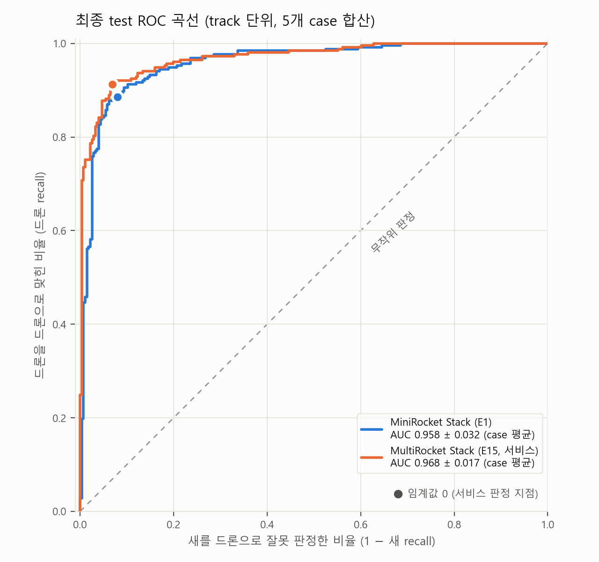
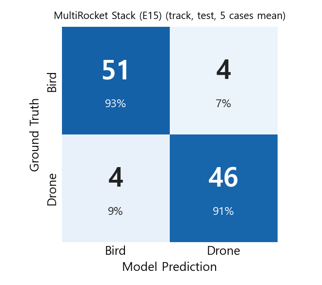

<div align="center">

# SkyDetect AI

**영상 속 비행 물체를 추적하고, 움직임 궤적만으로 드론과 새를 판별하는 AI 서버**

[시스템 구성](#시스템-구성) · [시작하기](#시작하기) · [API](#api) · [성능](#성능) · [문서](#문서)

</div>

---

## 개요

공항 주변에서는 조류와 드론을 빨리 구분해야 대응 방법을 정할 수 있습니다. 하지만 하늘을 찍은 영상에서 비행 물체는 수십 픽셀에 불과해 외형만으로는 구분이 어렵습니다.
SkyDetect는 **물체의 생김새 대신 움직이는 방식(궤적)** 을 보고 판별합니다.

이 저장소는 SkyDetect의 분석 파이프라인과 함께, 전체 시스템을 실행하는 Docker Compose 구성, GCP 배포 설정, 라즈베리파이 영상 송출 도구를 관리합니다.

| 단계 | 역할 | 주요 구현 |
| --- | --- | --- |
| **A. 추적** | 사용자가 지정한 영역(ROI)에서 물체를 프레임마다 추적해 `TrackSequence` 생성 | KLT 추적, 카메라 흔들림 보정, 온라인 외형 매칭, 칼만 필터 |
| **B. 특징 추출** | 궤적을 보간하고 속도·가속도·방향 변화 등 움직임 특징 계산 | 1920px 기준 좌표계 정규화, 프랙탈 지표 |
| **C. 분류** | 궤적을 새 / 드론 / 판단불가로 판정하고 판단 근거 제공 | MultiRocket Stack (기본), MiniRocket, RandomForest |

> 단국대학교 SW중심대학사업단 2026 캡스톤 프로젝트이며, **2026 캡스톤 페스티벌 우수상**을 받았습니다.

## 성능

최종 서비스 모델인 **MultiRocket Stack**의 test 결과입니다. 같은 촬영 영상이 학습과 평가에 함께 들어가지 않도록 촬영 그룹 단위로 데이터를 5조각으로 나누고, 5개 case의 평균을 보고합니다.

| 모델 | AUC | 새 recall | 드론 recall |
| --- | --- | --- | --- |
| **MultiRocket Stack** (서비스) | **0.968 ± 0.017** | **93%** | **91%** |
| MiniRocket Stack | 0.958 ± 0.032 | – | – |

<p align="center">
  
  
</p>

- 증강 데이터는 분할 뒤 각 split 안에서만 만들어, 같은 원본의 변형이 학습과 평가에 섞이지 않게 했습니다.
- 실험(E0~E18)은 validation으로만 비교했고, test는 최종 설정으로 한 번만 평가했습니다.
- 생성 스크립트: `research/c_part_final_report.py`, `research/c_part_roc_figure.py`

## 시스템 구성

SkyDetect는 세 저장소로 나뉩니다.

| 저장소 | 역할 |
| --- | --- |
| **skydetect-ai** (현재) | 추적·특징 추출·분류 AI 서버, 전체 실행 구성, 배포 설정, 라즈베리파이 도구 |
| [skydetect-backend](https://github.com/CAPSTONE-skydetect/skydetect-backend) | Spring Boot API. 인증, 회원, 실시간 클립, 관측 기록 |
| [skydetect-frontend](https://github.com/CAPSTONE-skydetect/skydetect-frontend) | Vue 3 관제 화면. 라이브 영상, ROI 지정, 판정 결과 |

```text
Browser / Mobile (PWA)
        │
        ▼
HTTP Load Balancer ─┬─ /       ─▶ Cloud Storage + Cloud CDN (frontend)
                    ├─ /api    ─▶ App VM: nginx gateway ─▶ Spring Boot ─▶ Cloud SQL (MySQL)
                    ├─ /whep   ─▶ App VM: MediaMTX (WebRTC preview)
                    └─ /ai*    ─▶ App VM ─▶ AI VM (internal only): MultiRocket Stack

Raspberry Pi ─RTSP─▶ MediaMTX ─▶ recorded segments ─▶ clip-bridge ─▶ clip (-3s ~ +10s)
```

## 시작하기

### 전체 시스템 (Docker Compose)

세 저장소를 같은 상위 폴더에 clone 한 뒤 실행합니다.

```bash
git clone https://github.com/CAPSTONE-skydetect/skydetect-ai.git
git clone https://github.com/CAPSTONE-skydetect/skydetect-backend.git
git clone https://github.com/CAPSTONE-skydetect/skydetect-frontend.git

cd skydetect-ai/docker
cp .env.example .env          # DB, 운영자 계정 비밀번호 입력
docker compose up -d --build
```

| 서비스 | 주소 |
| --- | --- |
| 관제 화면 | http://localhost:5173 |
| 백엔드 Swagger | http://localhost:8080/swagger-ui.html |
| AI (RandomForest) | http://localhost:8000/docs |
| AI (시퀀스 모델, 기본 MultiRocket Stack) | http://localhost:8001/docs |

자세한 내용은 [docker/README.md](docker/README.md)를 참고하세요.

### AI 서버만 실행

```bash
python -m venv .venv && source .venv/bin/activate
pip install -r requirements.txt
uvicorn ai_server.main:app --reload
```

http://127.0.0.1:8000/docs 에서 API 문서를 볼 수 있습니다. 사용할 분류 모델은 `SKYDETECT_MODEL` 환경 변수(`rf`, `minirocket`, `multirocket`)로 고릅니다.

## API

| Method | Path | 설명 |
| --- | --- | --- |
| `GET` | `/health` | 서버 상태 확인 |
| `POST` | `/analyze` | 영상 경로와 초기 bbox로 추적을 실행해 `TrackSequence` 반환 |
| `POST` | `/classify` | `TrackSequence`를 받아 판정 |
| `POST` | `/api/videos/upload` | 분석할 영상 업로드. 브라우저가 재생하지 못하는 코덱은 H.264로 변환 |
| `POST` | `/api/tracks/manual` | ROI 지정 추적 + 판정 (관제 화면용) |
| `GET` | `/api/files` | 추적 오버레이 등 결과 파일 다운로드 |

응답의 판정은 `bird` / `drone` / `uncertain` 중 하나이며, 판단 근거(RF는 피처별 기여도, 시퀀스 모델은 구간별 점수)를 함께 반환합니다.

<details>
<summary>요청 예시</summary>

```bash
curl -X POST http://127.0.0.1:8000/analyze \
  -H 'Content-Type: application/json' \
  -d '{
    "source_video_id": "sample-001",
    "video_path": "/absolute/path/to/video.mp4",
    "init_frame_index": 0,
    "target_bbox": [100, 80, 32, 32],
    "stabilize": true,
    "write_overlay": true
  }'
```

</details>

## 프로젝트 구조

```text
skydetect-ai/
├── ai_server/
│   ├── main.py              # FastAPI 진입점
│   ├── contracts/           # 파트 간 공유 데이터 계약 (TrackSequence 등)
│   ├── routers/             # analyze, classify, 관제 화면용 API
│   ├── services/            # A: 추적 · 흔들림 보정 / B: 특징 추출 / C: 규칙 필터
│   ├── classifiers/         # rf, minirocket, multirocket 분류기
│   └── utils/               # 보간, 품질 판정, 판단 근거 계산
├── models/                  # 배포용 모델 번들
├── research/                # 데이터셋 구성, 실험, 평가 스크립트
├── docker/                  # 로컬 전체 실행(Compose), GCP 배포 구성
├── hardware/raspberry-pi/   # 카메라 송출, 클립 추출 워커
├── docs/                    # 모델 문서, 평가 결과, 개발 가이드
└── tests/
```

## 테스트

```bash
pytest
```

`main`·`dev` 대상 PR마다 GitHub Actions가 모델별(rf, minirocket, multirocket) Docker 이미지를 빌드해 회귀 테스트를 실행합니다.

## 배포

`main`에 push 되면 GitHub Actions가 테스트 후 AI 서버와 clip-bridge 이미지를 Artifact Registry에 올리고, 각 VM이 1분 안에 새 이미지를 받아 재시작합니다. GCP 인증은 Workload Identity Federation을 사용해 저장소에 키 파일을 두지 않습니다.

구성과 운영 방법은 [docker/gcp/README.md](docker/gcp/README.md)를 참고하세요.

## 문서

| 문서 | 내용 |
| --- | --- |
| [docs/DEVELOPMENT.md](docs/DEVELOPMENT.md) | 파트별 담당 파일, 작업 규칙, 추적 파라미터 |
| [docs/model_unification.md](docs/model_unification.md) | RF / MiniRocket 런타임 통합 기록 |
| [docs/minirocket_stack_training.md](docs/minirocket_stack_training.md) | Stack 모델 학습 방법 |
| [docs/rf_evaluation.md](docs/rf_evaluation.md), [docs/minirocket_evaluation.md](docs/minirocket_evaluation.md) | 모델별 평가 결과 |
| [hardware/raspberry-pi/README.md](hardware/raspberry-pi/README.md) | 라즈베리파이 설정과 실시간 연동 |

## 팀

| 이름 | 담당 |
| --- | --- |
| [@moon4528](https://github.com/moon4528) | B. 궤적 특징 추출, 시뮬레이터와 학습 데이터 구성 |
| [@yuchanjung](https://github.com/yuchanjung) | A. 물체 추적, 라즈베리파이 연동, MiniRocket 모델 |
| [@donggyu-kang](https://github.com/donggyu-kang) | C. 분류 모델(MultiRocket Stack), 서비스 통합, 백엔드, GCP 배포 |

## 라이선스

[MIT License](LICENSE)
